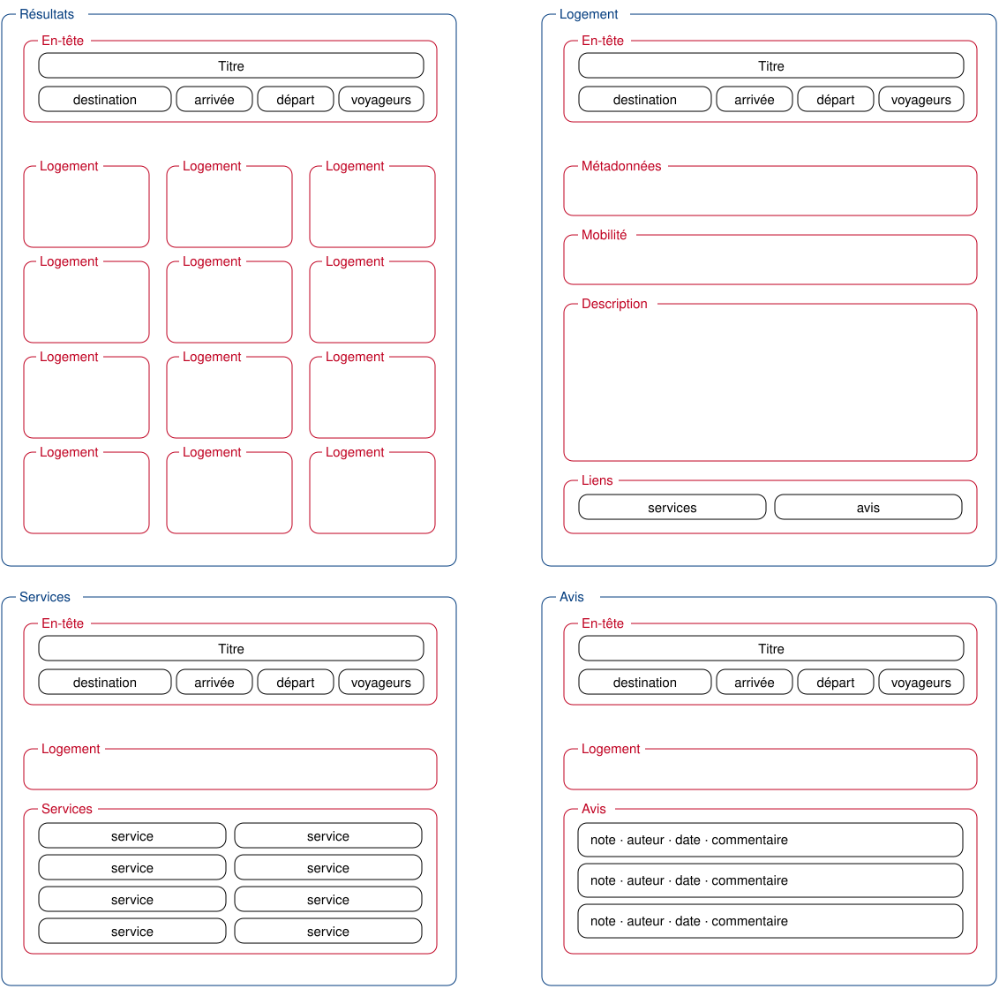
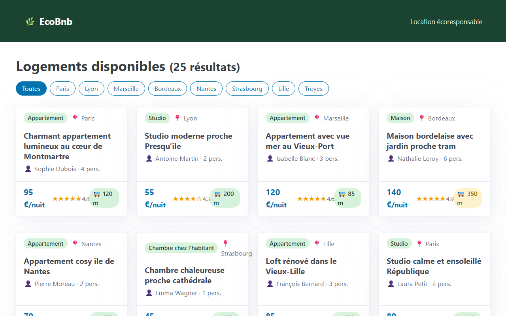
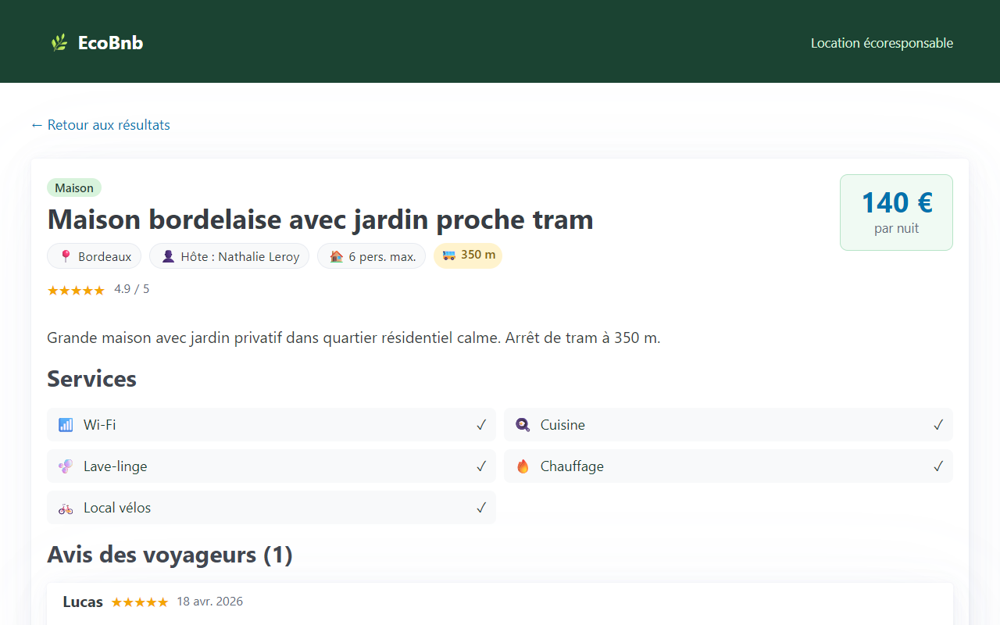

# EcoBnb

**Écologie + Airbnb**

## Choix du sujet

Airbnb est un service numérique qui permet de mettre en relation des personnes à la recherche d'un hébergement avec des particuliers ou des professionnels proposant un logement à la location.

Nous avons choisi d'étudier Airbnb car l'application est largement utilisée pour rechercher et réserver des logements lors de déplacements, notamment pour les vacances, les week-ends ou les déplacements professionnels.

L'intérêt de ce sujet est de mettre en évidence à la fois **l'utilité sociale et territoriale du service**, mais également les conséquences environnementales liées à sa numérisation et à l'augmentation des déplacements touristiques.

Notre objectif est donc d'identifier les principaux impacts du service numérique et de réfléchir à la manière dont sa conception pourrait être améliorée afin de limiter son empreinte environnementale.

## Utilité sociale

Airbnb facilite la mise en relation entre les voyageurs et les personnes qui proposent un logement.

Sur le plan social, le service permet notamment :

* de faciliter l'accès à différents types d'hébergements ;
* de mettre directement en relation les voyageurs et les hôtes ;
* de permettre à certains propriétaires de générer un revenu complémentaire ;
* de favoriser les échanges entre les voyageurs et les habitants ;
* de faciliter la découverte de nouvelles villes et de nouvelles cultures.

Le service peut également contribuer au développement des territoires. Les voyageurs ne dépensent pas uniquement leur argent dans leur logement : ils peuvent également consommer dans les restaurants, les commerces, les transports et les activités locales.

## Démocratie technique

Airbnb donne également une place importante aux utilisateurs dans le fonctionnement du service.

Les voyageurs peuvent laisser des **notes, des avis et des commentaires** après leur séjour. Ces informations permettent aux futurs voyageurs de comparer les logements et de faire leur choix.

Les hôtes peuvent également recevoir des retours de la part des voyageurs et améliorer leurs services.

Cette participation des utilisateurs contribue donc à l'amélioration du service et apporte davantage de transparence dans le choix d'un logement.

## Effets de la numérisation

La numérisation a profondément modifié la manière dont les personnes recherchent et réservent un hébergement.

Avant les plateformes numériques, il était courant de passer directement par un hôtel, une agence immobilière ou une agence de voyage pour trouver un hébergement.

Avec Airbnb, l'utilisateur peut désormais :

1. rechercher un logement ;
2. consulter sa localisation et ses caractéristiques ;
3. comparer plusieurs logements ;
4. consulter les avis des autres utilisateurs ;
5. contacter l'hôte ;
6. effectuer une réservation et un paiement en ligne.

Le numérique facilite donc considérablement la recherche et la réservation d'un logement.

Le bilan écologique de cette numérisation n'est pas simple à établir. D'un côté, la recherche en ligne évite des déplacements physiques (agence, office de tourisme) et des supports imprimés (catalogues, brochures). De l'autre, chaque page consultée sur les services actuels a un impact de l'ordre de 2 à 3 gCO2e (cf. [mesures des services concurrents](#impact-de-lexécution-des-scénarios-auprès-de-différents-services-concurrents)), et la recherche d'un logement implique souvent la consultation de dizaines d'annonces.

Retenons que, dans notre cas, le support numérique est potentiellement utile, mais que ce gain risque d'être annulé :

- si le service encourage la consultation d'un nombre élevé d'annonces (défilement infini, suggestions incessantes),
- si les pages sont beaucoup plus lourdes que la moyenne (photographies nombreuses et en haute résolution, cartes interactives, scripts tiers),
- si le service encourage des voyages supplémentaires ou plus lointains (effet rebond, cf. plus bas).

Nous serons donc particulièrement attentifs à ces trois risques dans la conception et le prototypage qui vont suivre.

## Substitution interactive entre le bailleur et le locataire

Airbnb constitue une alternative aux pratiques traditionnelles de réservation d'hébergement.

Au lieu de passer directement par un hôtel ou une agence de location, l'utilisateur peut rechercher et réserver directement un logement depuis l'application.

La plateforme permet également de valoriser des logements déjà existants, notamment des appartements, des maisons ou des chambres chez des particuliers.

Cette substitution peut éviter, dans certains cas, de recourir uniquement à de nouvelles infrastructures touristiques.

## Effets environnementaux

Sur le plan environnemental, l'utilisation de logements déjà existants peut présenter un intérêt.

Si la demande touristique est satisfaite grâce à des logements déjà construits, il n'est pas nécessaire de construire systématiquement de nouveaux hôtels ou bâtiments.

La construction de nouvelles infrastructures peut entraîner :

* une consommation importante de matériaux ;
* une consommation d'énergie ;
* une artificialisation des sols ;
* une destruction ou une dégradation d'espaces naturels.

Airbnb peut donc contribuer à mieux valoriser les logements existants.

## Effet rebond

L'effet rebond constitue une limite importante.

En facilitant la recherche de logements et en proposant des hébergements à différents niveaux de prix, Airbnb peut rendre certains voyages plus accessibles.

Une personne qui n'aurait peut-être pas effectué un déplacement en raison du prix élevé d'un hôtel peut être incitée à voyager grâce à un logement moins cher.

L'utilisation du service peut donc entraîner une augmentation du nombre de déplacements touristiques.

Cela peut provoquer des impacts environnementaux supplémentaires, notamment liés :

* aux déplacements en voiture ;
* aux voyages en avion ;
* à la consommation d'énergie pendant les séjours ;
* à l'augmentation de la fréquentation touristique de certains territoires.

## Réduction de l'impact écologique par la recommandation

### Prendre en compte les activités recherchées

L'application pourrait demander au voyageur quel type d'activités il souhaite réaliser pendant son séjour :

* visites culturelles ;
* restaurants ;
* activités sportives ;
* sorties nocturnes ;
* musées ;
* shopping ;
* événements, etc.

Airbnb pourrait ensuite proposer en priorité des logements situés à proximité de ces activités afin de limiter les déplacements.

### Favoriser les logements proches des transports en commun

L'application pourrait intégrer les informations sur les transports en commun afin de proposer des logements permettant de se déplacer facilement sans voiture.

Par exemple, Airbnb pourrait privilégier les logements :

* proches d'une station de bus, de tramway, de métro ou de train ;
* situés à proximité d'une ligne permettant d'accéder aux activités recherchées ;
* permettant de rejoindre plusieurs lieux d'intérêt avec peu ou pas de correspondances.

L'objectif serait de favoriser le déplacement :

**Logement → Transport en commun → Activité**

plutôt que :

**Logement → Voiture → Activité**

### Prendre en compte les préférences du voyageur

Avec l'accord de l'utilisateur, l'application pourrait conserver un historique de ses préférences et de ses choix précédents.

Par exemple, si un utilisateur choisit régulièrement des logements proches des transports en commun, Airbnb pourrait identifier cette préférence et proposer davantage de logements répondant à ce critère lors de ses prochaines recherches.

Le système pourrait ainsi apprendre progressivement les préférences de l'utilisateur et personnaliser les recommandations.

### Proposer un indicateur de mobilité

Pour aider l'utilisateur à faire un choix plus responsable, Airbnb pourrait afficher un indicateur de mobilité pour chaque logement.

Par exemple :

> **« 80 % des activités sélectionnées sont accessibles en moins de 30 minutes en transport en commun. »**

Cela permettrait au voyageur de prendre en compte non seulement le prix ou la note du logement, mais également la facilité de ses déplacements et leur impact environnemental.

### Partenariats avec les transports en commun

Airbnb pourrait créer des partenariats avec les réseaux de transports en commun afin de proposer des **réductions ou des pass de transport** aux voyageurs choisissant une option de mobilité écologique.

L'application pourrait également proposer directement les itinéraires en bus, tramway, métro ou train entre le logement et les activités choisies.

Cela permettrait de faciliter les déplacements des voyageurs tout en encourageant l'utilisation des transports en commun plutôt que de la voiture.

## Scénarios d'usage et impacts

Nous faisons l'hypothèse que la recherche d'un logement se fait en plusieurs sessions de quelques dizaines de minutes (le soir, pendant une pause, dans les transports en commun), durant lesquelles le voyageur consulte plusieurs annonces les unes à la suite des autres.
Pour cette raison, nous prendrons en compte dans nos scénarios la consultation de plusieurs annonces successives, avec des retours à la liste des résultats, afin d'apprécier l'effet bénéfique du cache.

Par ailleurs, nous distinguerons la simple consultation des logements d'une destination et la comparaison de plusieurs logements (photos, avis, prix, services), plus exigeante en nombre de pages consultées.

## Scénario : « Rechercher et consulter un logement » (scénario prioritaire)

1. Le voyageur se rend sur la page d'accueil du service grâce à un favori (donc sans passer par un moteur de recherche). Si nécessaire, il donne son consentement.
2. Il indique une destination et consulte la liste des logements proposés.
3. Il choisit un des logements et consulte son annonce jusqu'au bout.
4. Il revient à la liste des résultats et la consulte.
5. Il choisit un autre logement et consulte son annonce jusqu'au bout.

C'est ce scénario qui a été mesuré sur les services concurrents (cf. [`benchmark/`](./benchmark/)) puis sur notre prototype (cf. Tab.5).

Scénario : « Rechercher un logement »
L'utilisateur ouvre Airbnb.
Il indique une destination et ses dates de séjour.
Il consulte les résultats et applique éventuellement des filtres.
Il consulte plusieurs annonces et leurs informations.

Ce scénario permet d'observer l'impact lié à la recherche et à la consultation de plusieurs logements.

Scénario : « Comparer plusieurs logements »
L'utilisateur effectue une recherche.
Il consulte plusieurs annonces.
Il compare les photos, les avis, les prix et les caractéristiques.
Il revient aux résultats pour comparer les logements.
## EcoIndex

L'EcoIndex permet d'évaluer l'impact environnemental d'une page web à partir de différents indicateurs.

Nous nous intéresserons notamment :

* au nombre de requêtes effectuées ;
* au poids des données transférées ;
* au nombre d'éléments présents sur la page.

L'objectif sera de mesurer l'impact de différents scénarios d'utilisation du service Airbnb et d'identifier les éléments qui peuvent être optimisés.

Nous pourrons notamment comparer :

* la page de recherche ;
* une page présentant un logement ;
* la page de réservation.

## Impact de l'exécution des scénarios auprès de différents services concurrents

L'EcoIndex d'une page (de A à G) est calculé (sources : [EcoIndex](https://www.ecoindex.fr/comment-ca-marche/), [Octo](https://blog.octo.com/sous-le-capot-de-la-mesure-ecoindex), [GreenIT](https://github.com/cnumr/GreenIT-Analysis/blob/acc0334c712ba68939466c42af1514b5f448e19f/script/ecoIndex.js#L19-L44)) en fonction du positionnement de cette page parmi les pages mondiales concernant :

- le nombre de requêtes lancées,
- le poids des téléchargements,
- le nombre d'éléments du document.

Nous avons choisi de comparer l'impact du scénario « Rechercher et consulter un logement » sur trois services de réservation d'hébergements aux modèles différents : **Airbnb** (plateforme internationale entre particuliers), **Booking** (plateforme internationale, majoritairement hôtelière) et **Clévacances** (label français de locations de vacances, à titre de comparaison). Pour chaque service, les mesures portent sur la page d'accueil, une ou deux pages de résultats de recherche et deux ou trois annonces (cf. fichiers `input-file.json` de chaque service).

| Service | Score (sur 100) | Classe | Détail des mesures
| --- | --: | --: | --:
| Airbnb | 9 | G | […](./benchmark/AirBnb/ecoindex-environmental-statement.md)
| Booking | 17 | F | […](./benchmark/Booking/ecoindex-environmental-statement.md)
| Clévacances (à titre de comparaison) | 21 | F | […](./benchmark/Clevacances/ecoindex-environmental-statement.md)

__Tab.1__ : Mesure de l'EcoIndex moyen de services de réservation d'hébergements.

| Service | Page | Classe | EcoIndex | GES (gCO2e) | Requêtes | Taille de la page (ko) | Taille du DOM
| --- | --- | --: | --: | --: | --: | --: | --:
| Airbnb | Accueil | G | 7 | 2,85 | 210 | 5 348 | 2 540
| Airbnb | Résultats (Paris) | G | 7 | 2,87 | 231 | 6 314 | 4 719
| Airbnb | Annonce n°1 | F | 12 | 2,76 | 211 | 5 360 | 1 528
| Airbnb | Annonce n°2 | G | 8 | 2,84 | 243 | 5 629 | 2 122
| Airbnb | Annonce n°3 | G | 10 | 2,81 | 212 | 5 289 | 1 908
| Booking | Accueil | F | 18 | 2,63 | 101 | 3 264 | 4 106
| Booking | Résultats (Paris) | F | 11 | 2,79 | 161 | 4 097 | 4 924
| Booking | Annonce n°1 | G | 6 | 2,87 | 282 | 4 485 | 3 298
| Booking | Annonce n°2 | E | 29 | 2,43 | 89 | 768 | 3 487
| Booking | Résultats (Nice) | F | 23 | 2,53 | 93 | 1 721 | 5 015
| Clévacances | Accueil | F | 12 | 2,75 | 148 | 6 124 | 1 969
| Clévacances | Résultats (Ardèche) | G | 10 | 2,80 | 199 | 3 187 | 5 094
| Clévacances | Annonce n°1 | E | 35 | 2,29 | 67 | 1 012 | 1 668
| Clévacances | Annonce n°2 | E | 38 | 2,24 | 58 | 586 | 2 027
| Clévacances | Résultats (Gard) | F | 11 | 2,78 | 173 | 3 214 | 5 130

__Tab.2__ : Détail des mesures par page (mesures réalisées le 5 octobre 2026 avec `lighthouse-plugin-ecoindex`).

Les mesures de l'impact moyen de ces services (cf. Tab.1) révèlent des classes EcoIndex très faibles pour tous (F ou G), Airbnb obtenant la plus mauvaise note.

Dans le détail (cf. Tab.2), les pages les plus mal classées sont celles qui incluent :

- un très grand nombre de requêtes (plus de 200 par page chez Airbnb, jusqu'à 282 pour une annonce Booking),
- un poids de page très élevé (plus de 5 Mo pour chaque page d'Airbnb), dû notamment aux nombreuses photographies et aux scripts chargés,
- un DOM très volumineux (environ 5 000 éléments) sur les pages de résultats de recherche, qui affichent de nombreuses annonces, photos et cartes à la fois.

À l'inverse, le classement un peu meilleur (E) de certaines annonces de Clévacances et de Booking (moins de 90 requêtes et moins de 1 Mo) montre qu'il existe une marge de progression significative, à condition d'adopter des pratiques d'écoconception : limiter le nombre d'annonces et de photographies affichées, charger les informations secondaires (services, avis) uniquement à la demande, et réduire le recours aux services tiers.

## Modèle économique et rentabilité

Notre service repose uniquement sur une **commission prélevée sur chaque réservation**, payée par l'hôte. L'inscription et la publication d'une annonce sont gratuites : la plateforme ne gagne de l'argent que lorsqu'une réservation est effectuée.

Nous excluons la **publicité** et la **revente de données**, incompatibles avec l'écoconception et la confiance des utilisateurs.

### Hypothèses

Les montants ci-dessous sont des **estimations** pour une phase de lancement dans une ou deux villes (montants HT, par mois).

* Panier moyen d'une réservation : **150 €** (2 nuits à 75 €).
* Coût moyen d'un employé pour l'entreprise : **3 500 € par mois**, charges patronales comprises (soit environ 2 414 € brut, les charges représentant environ 45 % du brut).
* Frais du prestataire de paiement : environ **1,5 %** de chaque réservation.

### Coûts de personnel

| Poste | Nombre | Coût employeur mensuel par employé | Coût employeur total |
|---|--:|--:|--:|
| Développeur·se | 2 | 3 500 € | 7 000 € |
| Designer UX/UI | 1 | 3 500 € | 3 500 € |
| Chef·fe de projet | 1 | 3 500 € | 3 500 € |
| Service client (conseillers voyageurs et hôtes : chat, e-mail, téléphone) | 2 | 3 500 € | 7 000 € |
| Modération et vérification des annonces et des avis | 1 | 3 500 € | 3 500 € |
| Commercial·e (recrutement des hôtes) | 1 | 3 500 € | 3 500 € |
| **Total** | **8** | | **28 000 €** |

### Autres coûts fixes

| Poste | Coût mensuel |
|---|--:|
| Hébergement écoresponsable (serveurs, base de données, sauvegardes) | 600 € |
| Outils (nom de domaine, e-mails, gestion de code, design, supervision) | 400 € |
| Outils du service client (logiciel de tickets, chat, téléphonie) | 200 € |
| Comptabilité et juridique (externalisés) | 1 000 € |
| Assurances (responsabilité civile, garantie hôtes) | 500 € |
| Marketing de lancement (référencement, événements locaux) | 2 000 € |
| Locaux (coworking) | 1 500 € |
| Sécurité et maintenance (audits, mises à jour) | 300 € |
| **Total** | **6 500 €** |

**Coûts fixes mensuels totaux : 28 000 € + 6 500 € = 34 500 €.**

### Commission minimale pour être rentable

Le service est à l'équilibre quand les commissions couvrent les coûts. Le taux de commission minimal se calcule ainsi :

> **Commission minimale = coûts fixes ÷ volume de réservations + frais de paiement (1,5 %)**

où le volume de réservations est le nombre de réservations × 150 €.

| Réservations par mois | Volume de réservations | Commission minimale | Résultat mensuel avec une commission de 10 % |
|--:|--:|--:|--:|
| 1 000 | 150 000 € | 24,5 % | − 21 750 € |
| 2 000 | 300 000 € | 13,0 % | − 9 000 € |
| 3 000 | 450 000 € | 9,2 % | + 3 750 € |
| 4 000 | 600 000 € | 7,3 % | + 16 500 € |
| 5 000 | 750 000 € | 6,1 % | + 29 250 € |
| 10 000 | 1 500 000 € | 3,8 % | + 93 000 € |

### Lecture du tableau

* Nous visons une commission de **10 %**, plus faible que celle d'Airbnb (environ 15 % au total), pour attirer les hôtes.
* Chaque réservation rapporte en net 150 € × (10 % − 1,5 %) = **12,75 €**.
* Il faut donc environ **275 réservations par mois** pour payer un employé (3 500 € ÷ 12,75 €).
* Pour couvrir tous les coûts, il faut environ **2 710 réservations par mois** (34 500 € ÷ 12,75 €).
* En dessous de ce seuil, le service est déficitaire : la phase de lancement doit être financée par des fonds propres ou une levée de fonds, le temps d'atteindre ce volume.
* Au-delà de ce seuil, chaque réservation supplémentaire génère du bénéfice, car les coûts sont surtout fixes (salaires, locaux).
* Un site sobre réduit aussi les coûts d'hébergement : l'écoconception est donc à la fois un argument environnemental et économique.

## Maquette de l'interface et échantillon de données

Au vu des différents services comparés, des exigences environnementales exprimées plus haut et des scénarios retenus, nous avons défini pour notre prototype une maquette de l'interface et un échantillon de données réalistes.

Les ressources Web possédant une représentation sur notre application seront de quatre types :

- la liste des logements (avec une HTTP-URI ayant pour chemin `/`) ou, plus spécifiquement, des logements d'une destination donnée (avec pour chemin `/?city={name}`),
- un logement (avec pour chemin `/{id}`),
- les services d'un logement (avec pour chemin `/{id}/services`),
- les avis des voyageurs sur un logement (avec pour chemin `/{id}/reviews`).


__Fig.1__: Maquette de l'interface du prototype : __a.__ type de page pour les "résultats" (tous les logements ou ceux d'une destination), __b.__ type de page d'un logement, __c.__ type de page des services d'un logement, __d.__ type de page des avis sur un logement.

Dans un objectif de sobriété environnementale, les résultats sont pour l'instant limités à un petit nombre de logements (soit 20 à 30 logements).
De même, les services et les avis d'un logement ne sont pas affichés sur la page du logement mais sur des pages séparées, accessibles par un lien : ils ne sont ainsi chargés que si le voyageur les demande.

Pour des raisons de respect des droits d'auteurs et de protection des données personnelles des hôtes, nous utilisons des données générées (avec [`dummy-json`](https://dummyjson.com)).
Bien que fictives, ces données correspondent à la structure des services concurrents : les logements comportent un titre possiblement long, une ville, un type, un hôte, un prix par nuit, une capacité, une note et une description, auxquels nous ajoutons la distance à l'arrêt de transport en commun le plus proche, nécessaire à notre indicateur de mobilité. Les services (wifi, cuisine, lave-linge, chauffage, local à vélos) et les avis des voyageurs (auteur, date, note, commentaire) sont rattachés directement au logement qu'ils concernent et peuvent être absents (`null`) lorsqu'un logement n'a pas renseigné ses services ou n'a pas encore reçu d'avis (voir [modèle de données](./frontend/sample_data.hbs)).

### Étape de prototypage : Données chargées de manière statique

Pour cette première version du prototype (`v1.0.0`) :

- l'échantillon de données est encore chargé dans le code de manière statique (intégré dans le bundle JavaScript au moment du `build`),
- les fonctionnalités implémentées sont celles nécessaires pour suivre le scénario prioritaire (« Rechercher et consulter un logement »).

Ce scénario nécessite de pouvoir naviguer entre deux types de page : la page de la liste des logements et les pages de détail d'un logement.

#### Page de la liste des logements

Nous avons développé la page de la liste (cf. Fig. 2) pour qu'elle affiche l'échantillon de données sous une forme proche de ce que prévoyait la maquette. Un filtre par ville permet de réduire les résultats affichés.


__Fig.2__ : Prototype de la page de la liste des logements.

Nous avons choisi un *framework* de mise en page minimaliste (*PicoCSS*). Dans la suite du projet, nous vérifierons si l'impact environnemental du passage à un *framework* plus puissant (comme *Bootstrap*) serait acceptable.

De même, nous avons décidé de ne pas inclure de photographies dans cette page. Même si ces photographies ont probablement un impact sur l'attention portée à une annonce, elles ne sont pas strictement requises pour la consultation de la liste et ne sont donc pas incluses dans le produit minimum viable. Si une telle fonctionnalité devait par la suite être introduite, il faudrait mettre en balance son utilité et son impact a priori important : à moins de mettre en place des techniques avancées d'optimisation, une requête supplémentaire serait nécessaire pour chaque image.

Dans l'état actuel du prototype, il est possible d'avoir une première idée de l'impact environnemental du *frontend*. Il manque encore le chargement dynamique des données, mais nous pouvons déjà évaluer l'impact de l'affichage des données et du *framework* (au sens large : React, PicoCSS, DayJS). Cette évaluation (cf. Tab.4) est encourageante en mode « développement » mais encore plus en mode « pré-production », ce qui illustre l'effet positif de la minification et de la concaténation des ressources opérées par *Vite*.

|   | EcoIndex | GES (gCO2e) | Taille du DOM | Requêtes | Taille de la page (ko)
|---|--------:|------------:|--------------:|---------:|---------------------:
| Mode « développement » | 66 C | 1,68 | 350 | 21 | 5 162
| Mode « pré-production » | 82 A | 1,36 | 349 | 4 | 101

__Tab.4__ : Évaluation de l'impact de la page de la liste des logements en mode « développement » (`npm run dev`, port 5173) et en mode « pré-production » (`npm run build` + `npm run preview`, port 4173).

#### Page de détail d'un logement

Les pages de détail ont pour HTTP-URI `/{id}`. Nous avons implémenté cette page (cf. Fig. 3) conformément à ce que prévoyait la maquette, en affichant la description du logement, ses services et les avis des voyageurs.


__Fig.3__ : Prototype de la page de détail d'un logement.

Avec l'ajout de ce modèle de page et la navigation entre les deux types de page, il devient possible d'exécuter le scénario prioritaire complet et de mesurer son impact (cf. Tab.5).

|   | EcoIndex | GES (gCO2e) | Taille du DOM | Requêtes | Taille de la page (ko)
|---|--------:|------------:|--------------:|---------:|---------------------:
| 1. Consulter la liste des logements   | 82 A | 1,36 | 349 | 3 | 101
| 2. Consulter le détail d'un logement  | 94 A | 1,13 |  62 | 3 |   1
| 3. Revenir à la liste et choisir un autre logement | 94 A | 1,12 |  57 | 3 |   1

__Tab.5__ : Évaluation de l'impact du scénario « Rechercher et consulter un logement » dans le prototype `v1.0.0` (mesures réalisées en mode pré-production avec `lighthouse-plugin-ecoindex`).

Ces estimations, bien qu'artificiellement basses (les données étant intégrées au bundle, aucune requête réseau n'est effectuée pour les données elles-mêmes), sont tout de même à comparer avec [celles des services concurrents](./benchmark/) mesurés précédemment : Airbnb obtient un grade G (9/100), Booking F (17/100) et Clévacances F (21/100). Notre prototype atteint le grade A dès la première page, avec des émissions environ **8 fois inférieures** à celles d'Airbnb.

### Étape de prototypage : Données statiques chargées de manière dynamique

Pour cette nouvelle version du prototype (`v1.0.1`), identique du point de vue fonctionnel, les données (toujours statiques) sont désormais chargées par le *frontend* à travers le réseau immédiatement après un premier affichage à vide, via `fetch()` et `useEffect()`. Ce comportement, plus réaliste, n'a pour effet qu'une requête supplémentaire par page affichée.

Concernant l'évaluation de l'impact environnemental du scénario, par rapport au tableau précédent (cf. Tab.5), à l'exception du nombre de requêtes qui est incrémenté de 1, les résultats sont strictement identiques grâce au cache navigateur à partir de la deuxième page.

## Mesure de la consommation énergétique lors du passage à l'échelle

L'échantillon actuel (25 logements, 72 avis) pèse environ **44 ko**. D'après cet échantillon, un logement sans ses avis occupe environ **1,2 ko** et un avis environ **200 octets**. Mais en production, plusieurs types de données se multiplieraient avec l'usage du service.

Les estimations ci-dessous reprennent les hypothèses du modèle économique : une phase de lancement dans une ou deux villes, avec environ 3 000 réservations par mois (seuil de rentabilité), puis une phase nationale à environ 10 000 réservations par mois.

| Données | Ce qui les fait augmenter | Taille unitaire estimée | Lancement (par an) | Phase nationale (par an) |
|---|---|--:|--:|--:|
| Annonces de logements | Inscription de nouveaux hôtes | ~ 1,2 ko | ~ 2 000 annonces, ~ 2,4 Mo | ~ 50 000 annonces, ~ 60 Mo |
| Comptes (voyageurs et hôtes) | Chaque nouvel utilisateur | ~ 0,5 ko | ~ 30 000 comptes, ~ 15 Mo | ~ 100 000 comptes, ~ 50 Mo |
| Réservations | Chaque réservation | ~ 0,3 ko | ~ 36 000, ~ 11 Mo | ~ 120 000, ~ 36 Mo |
| Avis des voyageurs | Environ un avis pour deux réservations | ~ 0,2 ko | ~ 18 000, ~ 3,6 Mo | ~ 60 000, ~ 12 Mo |
| Messages entre hôte et voyageur | Environ 5 messages par réservation | ~ 0,3 ko | ~ 180 000, ~ 54 Mo | ~ 600 000, ~ 180 Mo |

__Tab.6__ : Estimation de l'ordre de grandeur des données qui se multiplient avec l'usage du service.

Ces volumes restent modestes pour le stockage (quelques centaines de Mo par an). En revanche, s'ils ne sont jamais supprimés, ils **s'accumulent année après année**. Le stockage, les sauvegardes et la durée des requêtes en base de données augmentent alors indéfiniment.

Le principal risque concerne les **données transférées vers le navigateur**. Dans le prototype, toute la liste est envoyée en un seul fichier. Avec 50 000 annonces, ce fichier dépasserait **60 Mo** pour chaque affichage de la page de résultats, contre 44 ko aujourd'hui. Pour garder un impact proche de celui mesuré (cf. Tab.5), il faudra :

* filtrer les logements côté serveur (par ville) et limiter le nombre de résultats envoyés (20 à 30 logements par page, comme prévu dans la maquette) ;
* continuer à charger les avis et les services uniquement sur leurs pages dédiées (`/{id}/reviews`, `/{id}/services`), puisque le nombre d'avis d'un logement augmente sans limite avec le temps.

### Politique de suppression des données

Pour éviter que les données augmentent sans limite, nous appliquerons la politique de suppression suivante :

* **Les comptes inactifs depuis 1 an** (aucune connexion, réservation ni modification) sont supprimés, ainsi que les données qui leur sont rattachées.
* **Les annonces inactives depuis 1 an** (aucune réservation ni mise à jour) sont supprimées.
* **Les annonces déjà prises** (logement déjà réservé) sont **supprimées immédiatement** : elles ne sont pas archivées et n'apparaissent plus dans les résultats.

Avec cette politique, le volume de données ne dépend plus du temps écoulé depuis le lancement du service. Il dépend seulement de l'activité de la dernière année : il reste borné aux ordres de grandeur du Tab.6 au lieu de les additionner chaque année.

### Évolution de l'EcoIndex lors du passage à l'échelle

Pour simuler le passage à l'échelle, nous avons généré, à partir du même [modèle de données](./frontend/sample_data.hbs), un échantillon de **2 000 logements** (ordre de grandeur de la phase de lancement, cf. Tab.6), soit un fichier de données de **4,2 Mo** au lieu de 44 ko. Le scénario « Rechercher et consulter un logement » a ensuite été mesuré dans les mêmes conditions que précédemment (mode pré-production, `lighthouse-plugin-ecoindex`).

Les mesures [avant](./ecoindex-reports/) et [après](./ecoindex-scaled-reports/) la simulation du passage à l'échelle montrent bien (cf. Tab.7) l'augmentation du poids des téléchargements, mais aussi l'augmentation du nombre d'éléments de la page de la liste des logements.

|   | EcoIndex | GES (gCO2e) | Taille du DOM | Requêtes | Taille de la page (ko)
|---|--------:|------------:|--------------:|---------:|---------------------:
| 1. Consulter la liste des logements | ~~82 A~~<br>44 D | ~~1,36~~<br>2,12 | ~~349~~<br>26 024 | 4 | ~~104~~<br>1 044
| 2. Consulter le détail d'un logement | ~~94 A~~<br>93 A | ~~1,13~~<br>1,14 | ~~62~~<br>66 | 4 | 1
| 3. Revenir à la liste et choisir un autre logement | 94 A | 1,12 | ~~57~~<br>54 | 4 | 1

__Tab.7__ : Effet du passage à l'échelle (25 → 2 000 logements) sur l'impact du scénario « Rechercher et consulter un logement » dans le prototype `v1.0.1` (valeurs barrées : mesures avant la simulation).

La page de la liste est la plus touchée : elle affiche désormais tous les logements, d'où un DOM **75 fois plus grand** et une note qui passe de A à D. Les pages de détail ne changent presque pas, car le fichier de données est déjà dans le cache du navigateur. Leur rendu ne dépend que d'un seul logement.

La taille transférée (1 044 ko) est mesurée avec la compression gzip du serveur de pré-production. Sans compression, comme avec la configuration nginx actuelle, le navigateur téléchargerait les **4,2 Mo** complets. À l'échelle nationale (50 000 logements), le fichier dépasserait 100 Mo. Ces mesures confirment donc que le filtrage par ville et la limitation du nombre de résultats côté serveur sont indispensables avant la mise en production.

### Automatisation de la mesure en intégration continue

Pour que les mesures soient reproductibles et publiques, le scénario prioritaire est désormais décrit dans [`scenarios/rechercher_et_consulter_un_logement.yml`](./scenarios/rechercher_et_consulter_un_logement.yml) et exécuté par [GreenIT Analysis CLI](https://github.com/cnumr/GreenIT-Analysis-cli). Le robot y reproduit les actions du voyageur : consulter la liste, filtrer par ville, ouvrir une annonce, revenir aux résultats, ouvrir une seconde annonce.

À chaque nouvelle version poussée, le [script d'intégration continue](./.github/workflows/test.yml) :

1. construit le *frontend* (`build`) ;
2. génère l'échantillon de données à partir du [modèle](./frontend/sample_data.hbs) (`build_samples`), plutôt que de journaliser dans Git un fichier volumineux ;
3. démarre l'application avec nginx et y exécute le scénario (`measure_ecoindex`) ;
4. publie le rapport HTML comme artefact `EcoIndex` de l'exécution.

Pour lancer la mesure localement (application démarrée sur le port 80, Node 24) :

```sh
greenit analyse --format html --headless false scenarios/rechercher_et_consulter_un_logement.yml
```

### Passage à l'échelle mesuré avec GreenIT Analysis

Nous avons d'abord tenté de multiplier les données par **100** (2 500 logements, 6 535 avis, fichier de **5,1 Mo**). La mesure s'est alors révélée impossible : l'analyse de la page de la liste dépasse le délai maximal du navigateur piloté (180 s, erreur `Runtime.callFunctionOn timed out`), et après trois essais, soit plus de 9 minutes, aucun résultat n'est produit. Ce délai serait inacceptable à chaque version en intégration continue. Il montre surtout qu'une page affichant tous les logements devient trop lourde même pour un navigateur de bureau.

Nous avons donc retenu un passage à l'ordre de grandeur supérieur : **×10** (250 logements, fichier de **482 ko** au lieu de 52 ko). Le scénario s'exécute alors en **3 min 17 s** au lieu de 49 s.

| Étape | Classe | GES (gCO2e) | Eau (cl) | Taille du DOM | Requêtes | Taille de la page (ko)
|---|--:|--:|--:|--:|--:|--:
| 1. Consulter la liste des logements | ~~B~~<br>D | ~~2,25~~<br>3,30 | ~~1,50~~<br>2,20 | ~~358~~<br>3 283 | 5 | ~~415~~<br>844
| 2. Filtrer par ville | B | ~~1,95~~<br>2,52 | ~~1,30~~<br>1,68 | ~~85~~<br>514 | 5 | ~~415~~<br>844
| 3. Consulter un logement | A | ~~1,86~~<br>1,98 | ~~1,24~~<br>1,32 | ~~62~~<br>101 | 2 | ~~53~~<br>483
| 4. Revenir à la liste | ~~A~~<br>D | ~~2,19~~<br>3,24 | ~~1,46~~<br>2,16 | ~~358~~<br>3 283 | 2 | ~~53~~<br>483
| 5. Consulter un autre logement | A | ~~1,86~~<br>1,92 | ~~1,24~~<br>1,28 | ~~71~~<br>62 | 2 | ~~53~~<br>483

__Tab.8__ : Effet du passage à l'échelle (25 → 250 logements) sur le scénario « Rechercher et consulter un logement », mesuré avec GreenIT Analysis (valeurs barrées : mesures avant la simulation ; rapports [avant](./greenit-reports/avant-passage-a-l-echelle.html) et [après](./greenit-reports/apres-passage-a-l-echelle.html)).

Dans le détail :

- **La liste des logements** est la plus touchée. Son DOM est multiplié par 9 (de 358 à 3 283 éléments), presque proportionnellement aux données, car chaque logement donne une carte. Ses émissions augmentent de 47 % et sa classe passe de B à D, à l'aller comme au retour.
- **Le filtre par ville** limite l'effet (514 éléments, classe B). Cela confirme l'intérêt de n'afficher que les logements d'une destination.
- **Les pages d'un logement** gardent un DOM quasi constant (les variations viennent du nombre aléatoire d'avis) et restent en classe A. En revanche, la taille transférée passe de 53 à 483 ko : chaque page télécharge le **fichier de données complet** pour n'afficher qu'un seul logement. Cet impact croît donc linéairement avec le nombre d'annonces, sur toutes les pages.
- **Aucune ressource n'est compressée** (indicateur « 0 % ressources compressées »). Activer gzip dans nginx diviserait la taille du JSON par 4 environ (cf. Tab.7).
- En extrapolant, le passage à ×100 donnerait plus de 30 000 éléments et plus de 5 Mo par page, d'où l'échec de la mesure.

Ces résultats confirment les priorités identifiées plus haut : pagination et filtrage côté serveur, chargement d'un seul logement par page de détail (`/{id}`) et compression des réponses.

### Mesure de la consommation énergétique liée à la consultation

Le logiciel [GreenFrame](https://github.com/benel/greenframe-cli/tree/post-app) est capable d'estimer, pour les différents composants de l'architecture, la consommation énergétique :

- du CPU (à partir du temps de calcul),
- de la mémoire vive (à partir de la taille des données mémorisées),
- du disque (à partir de la taille des données lues et écrites),
- du réseau (à partir de la taille des données reçues et envoyées),
- pour le navigateur uniquement, de l'écran (à partir du temps d'exécution du scénario).

Nous avons écrit un scénario minimal pour chacun des deux types de page du prototype : [consulter la liste des logements](./scenarios/consult_listings.js) (`/`) et [consulter un logement](./scenarios/consult_listing.js) (`/0`). Chaque scénario charge la page, attend 10 s (temps de lecture), fait défiler la page jusqu'en bas puis attend 7 s. Les scénarios, l'URI de l'application et le conteneur mesuré (`ecobnb-static_hosting-1`, le serveur nginx) sont déclarés dans le [fichier de configuration de GreenFrame](./.greenframe.yml). La mesure est lancée automatiquement à chaque version poussée (tâche `measure_greenframe` du [script d'intégration continue](./.github/workflows/test.yml)), et son résultat est publié comme artefact `GreenFrame` de l'exécution.

| (a)         | cpu (Wh) | mem (Wh) | disk (Wh) | network (Wh) | screen (Wh) | total (Wh) |
| ----------- | -------- | -------- | --------- | ------------ | ----------- | ---------- |
| Navigateur  |          |          |           |              |             |            |
| Serveur Web |          |          |           |              |             |            |

| (b)         | cpu (Wh) | mem (Wh) | disk (Wh) | network (Wh) | screen (Wh) | total (Wh) |
| ----------- | -------- | -------- | --------- | ------------ | ----------- | ---------- |
| Navigateur  |          |          |           |              |             |            |
| Serveur Web |          |          |           |              |             |            |

__Tab.9__ : Estimation de la consommation énergétique de la consultation de la liste des logements (premier tableau) et d'un logement (second tableau).

<!-- TODO : compléter avec les valeurs de l'artefact GreenFrame et interpréter -->

## Conclusion

Airbnb facilite les échanges entre voyageurs et hébergeurs et contribue à valoriser les logements existants. Cependant, il peut aussi encourager davantage de déplacements touristiques et donc augmenter son impact environnemental.

Notre solution consiste à améliorer la logique de recommandation en prenant en compte les activités, les préférences du voyageur et la proximité des transports en commun. L'objectif est de proposer des logements permettant de limiter les déplacements en voiture et de favoriser une mobilité plus durable.
