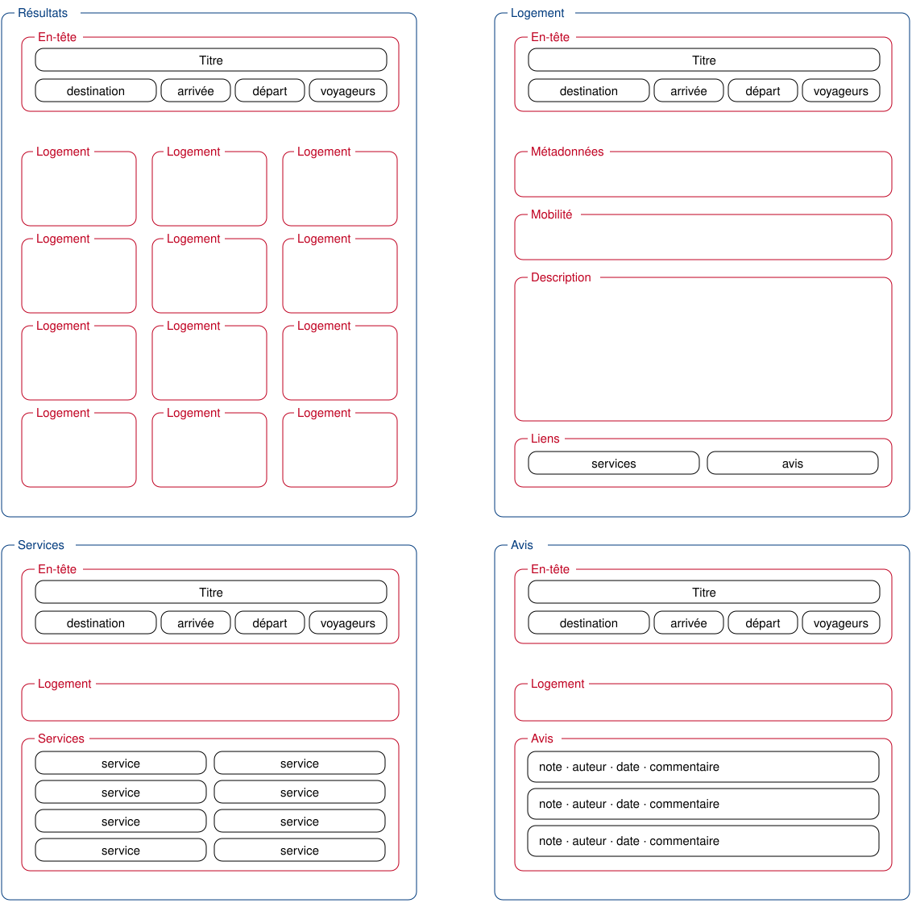

# Airbnb

**Écologie + Airbnb**

## Choix du sujet

Airbnb est un service numérique qui permet de mettre en relation des personnes à la recherche d'un hébergement avec des particuliers ou des professionnels proposant un logement à la location.

Nous avons choisi d'étudier Airbnb car l'application est largement utilisée pour rechercher et réserver des logements lors de déplacements, notamment pour les vacances, les week-ends ou les déplacements professionnels.

L'intérêt de ce sujet est de mettre en évidence à la fois **l'utilité sociale et territoriale du service**, mais également les conséquences environnementales liées à sa numérisation et à l'augmentation des déplacements touristiques.

Notre objectif est donc d'identifier les principaux impacts du service numérique et de réfléchir à la manière dont sa conception pourrait être améliorée afin de limiter son empreinte environnementale.

## Utilité sociale

Airbnb facilite la mise en relation entre les voyageurs et les personnes qui proposent un logement.

Sur le plan social, le service permet notamment :

* de faciliter l'accès à différents types d'hébergements ;
* de mettre directement en relation les voyageurs et les hôtes ;
* de permettre à certains propriétaires de générer un revenu complémentaire ;
* de favoriser les échanges entre les voyageurs et les habitants ;
* de faciliter la découverte de nouvelles villes et de nouvelles cultures.

Le service peut également contribuer au développement des territoires. Les voyageurs ne dépensent pas uniquement leur argent dans leur logement : ils peuvent également consommer dans les restaurants, les commerces, les transports et les activités locales.

## Démocratie technique

Airbnb donne également une place importante aux utilisateurs dans le fonctionnement du service.

Les voyageurs peuvent laisser des **notes, des avis et des commentaires** après leur séjour. Ces informations permettent aux futurs voyageurs de comparer les logements et de faire leur choix.

Les hôtes peuvent également recevoir des retours de la part des voyageurs et améliorer leurs services.

Cette participation des utilisateurs contribue donc à l'amélioration du service et apporte davantage de transparence dans le choix d'un logement.

## Effets de la numérisation

La numérisation a profondément modifié la manière dont les personnes recherchent et réservent un hébergement.

Avant les plateformes numériques, il était courant de passer directement par un hôtel, une agence immobilière ou une agence de voyage pour trouver un hébergement.

Avec Airbnb, l'utilisateur peut désormais :

1. rechercher un logement ;
2. consulter sa localisation et ses caractéristiques ;
3. comparer plusieurs logements ;
4. consulter les avis des autres utilisateurs ;
5. contacter l'hôte ;
6. effectuer une réservation et un paiement en ligne.

Le numérique facilite donc considérablement la recherche et la réservation d'un logement.

## Substitution interactive entre le bailleur et le locataire

Airbnb constitue une alternative aux pratiques traditionnelles de réservation d'hébergement.

Au lieu de passer directement par un hôtel ou une agence de location, l'utilisateur peut rechercher et réserver directement un logement depuis l'application.

La plateforme permet également de valoriser des logements déjà existants, notamment des appartements, des maisons ou des chambres chez des particuliers.

Cette substitution peut éviter, dans certains cas, de recourir uniquement à de nouvelles infrastructures touristiques.

## Effets environnementaux

Sur le plan environnemental, l'utilisation de logements déjà existants peut présenter un intérêt.

Si la demande touristique est satisfaite grâce à des logements déjà construits, il n'est pas nécessaire de construire systématiquement de nouveaux hôtels ou bâtiments.

La construction de nouvelles infrastructures peut entraîner :

* une consommation importante de matériaux ;
* une consommation d'énergie ;
* une artificialisation des sols ;
* une destruction ou une dégradation d'espaces naturels.

Airbnb peut donc contribuer à mieux valoriser les logements existants.

## Effet rebond

L'effet rebond constitue une limite importante.

En facilitant la recherche de logements et en proposant des hébergements à différents niveaux de prix, Airbnb peut rendre certains voyages plus accessibles.

Une personne qui n'aurait peut-être pas effectué un déplacement en raison du prix élevé d'un hôtel peut être incitée à voyager grâce à un logement moins cher.

L'utilisation du service peut donc entraîner une augmentation du nombre de déplacements touristiques.

Cela peut provoquer des impacts environnementaux supplémentaires, notamment liés :

* aux déplacements en voiture ;
* aux voyages en avion ;
* à la consommation d'énergie pendant les séjours ;
* à l'augmentation de la fréquentation touristique de certains territoires.

## Réduction de l'impact écologique par la recommandation

### Prendre en compte les activités recherchées

L'application pourrait demander au voyageur quel type d'activités il souhaite réaliser pendant son séjour :

* visites culturelles ;
* restaurants ;
* activités sportives ;
* sorties nocturnes ;
* musées ;
* shopping ;
* événements, etc.

Airbnb pourrait ensuite proposer en priorité des logements situés à proximité de ces activités afin de limiter les déplacements.

### Favoriser les logements proches des transports en commun

L'application pourrait intégrer les informations sur les transports en commun afin de proposer des logements permettant de se déplacer facilement sans voiture.

Par exemple, Airbnb pourrait privilégier les logements :

* proches d'une station de bus, de tramway, de métro ou de train ;
* situés à proximité d'une ligne permettant d'accéder aux activités recherchées ;
* permettant de rejoindre plusieurs lieux d'intérêt avec peu ou pas de correspondances.

L'objectif serait de favoriser le déplacement :

**Logement → Transport en commun → Activité**

plutôt que :

**Logement → Voiture → Activité**

### Prendre en compte les préférences du voyageur

Avec l'accord de l'utilisateur, l'application pourrait conserver un historique de ses préférences et de ses choix précédents.

Par exemple, si un utilisateur choisit régulièrement des logements proches des transports en commun, Airbnb pourrait identifier cette préférence et proposer davantage de logements répondant à ce critère lors de ses prochaines recherches.

Le système pourrait ainsi apprendre progressivement les préférences de l'utilisateur et personnaliser les recommandations.

### Proposer un indicateur de mobilité

Pour aider l'utilisateur à faire un choix plus responsable, Airbnb pourrait afficher un indicateur de mobilité pour chaque logement.

Par exemple :

> **« 80 % des activités sélectionnées sont accessibles en moins de 30 minutes en transport en commun. »**

Cela permettrait au voyageur de prendre en compte non seulement le prix ou la note du logement, mais également la facilité de ses déplacements et leur impact environnemental.

### Partenariats avec les transports en commun

Airbnb pourrait créer des partenariats avec les réseaux de transports en commun afin de proposer des **réductions ou des pass de transport** aux voyageurs choisissant une option de mobilité écologique.

L'application pourrait également proposer directement les itinéraires en bus, tramway, métro ou train entre le logement et les activités choisies.

Cela permettrait de faciliter les déplacements des voyageurs tout en encourageant l'utilisation des transports en commun plutôt que de la voiture.
Scénario : « Rechercher un logement »
L'utilisateur ouvre Airbnb.
Il indique une destination et ses dates de séjour.
Il consulte les résultats et applique éventuellement des filtres.
Il consulte plusieurs annonces et leurs informations.

Ce scénario permet d'observer l'impact lié à la recherche et à la consultation de plusieurs logements.

Scénario : « Comparer plusieurs logements »
L'utilisateur effectue une recherche.
Il consulte plusieurs annonces.
Il compare les photos, les avis, les prix et les caractéristiques.
Il revient aux résultats pour comparer les logements.
## EcoIndex

L'EcoIndex permet d'évaluer l'impact environnemental d'une page web à partir de différents indicateurs.

Nous nous intéresserons notamment :

* au nombre de requêtes effectuées ;
* au poids des données transférées ;
* au nombre d'éléments présents sur la page.

L'objectif sera de mesurer l'impact de différents scénarios d'utilisation du service Airbnb et d'identifier les éléments qui peuvent être optimisés.

Nous pourrons notamment comparer :

* la page de recherche ;
* une page présentant un logement ;
* la page de réservation.

## Modèle économique et rentabilité

Notre service repose uniquement sur une **commission prélevée sur chaque réservation**, payée par l'hôte. L'inscription et la publication d'une annonce sont gratuites : la plateforme ne gagne de l'argent que lorsqu'une réservation est effectuée.

Nous excluons la **publicité** et la **revente de données**, incompatibles avec l'écoconception et la confiance des utilisateurs.

### Hypothèses

Les montants ci-dessous sont des **estimations** pour une phase de lancement dans une ou deux villes (montants HT, par mois).

* Panier moyen d'une réservation : **150 €** (2 nuits à 75 €).
* Coût moyen d'un employé pour l'entreprise : **3 500 € par mois**, charges patronales comprises (soit environ 2 414 € brut, les charges représentant environ 45 % du brut).
* Frais du prestataire de paiement : environ **1,5 %** de chaque réservation.

### Coûts de personnel

| Poste | Nombre | Coût employeur mensuel par employé | Coût employeur total |
|---|--:|--:|--:|
| Développeur·se | 2 | 3 500 € | 7 000 € |
| Designer UX/UI | 1 | 3 500 € | 3 500 € |
| Chef·fe de projet | 1 | 3 500 € | 3 500 € |
| Service client (conseillers voyageurs et hôtes : chat, e-mail, téléphone) | 2 | 3 500 € | 7 000 € |
| Modération et vérification des annonces et des avis | 1 | 3 500 € | 3 500 € |
| Commercial·e (recrutement des hôtes) | 1 | 3 500 € | 3 500 € |
| **Total** | **8** | | **28 000 €** |

### Autres coûts fixes

| Poste | Coût mensuel |
|---|--:|
| Hébergement écoresponsable (serveurs, base de données, sauvegardes) | 600 € |
| Outils (nom de domaine, e-mails, gestion de code, design, supervision) | 400 € |
| Outils du service client (logiciel de tickets, chat, téléphonie) | 200 € |
| Comptabilité et juridique (externalisés) | 1 000 € |
| Assurances (responsabilité civile, garantie hôtes) | 500 € |
| Marketing de lancement (référencement, événements locaux) | 2 000 € |
| Locaux (coworking) | 1 500 € |
| Sécurité et maintenance (audits, mises à jour) | 300 € |
| **Total** | **6 500 €** |

**Coûts fixes mensuels totaux : 28 000 € + 6 500 € = 34 500 €.**

### Commission minimale pour être rentable

Le service est à l'équilibre quand les commissions couvrent les coûts. Le taux de commission minimal se calcule ainsi :

> **Commission minimale = coûts fixes ÷ volume de réservations + frais de paiement (1,5 %)**

où le volume de réservations est le nombre de réservations × 150 €.

| Réservations par mois | Volume de réservations | Commission minimale | Résultat mensuel avec une commission de 10 % |
|--:|--:|--:|--:|
| 1 000 | 150 000 € | 24,5 % | − 21 750 € |
| 2 000 | 300 000 € | 13,0 % | − 9 000 € |
| 3 000 | 450 000 € | 9,2 % | + 3 750 € |
| 4 000 | 600 000 € | 7,3 % | + 16 500 € |
| 5 000 | 750 000 € | 6,1 % | + 29 250 € |
| 10 000 | 1 500 000 € | 3,8 % | + 93 000 € |

### Lecture du tableau

* Nous visons une commission de **10 %**, plus faible que celle d'Airbnb (environ 15 % au total), pour attirer les hôtes.
* Chaque réservation rapporte en net 150 € × (10 % − 1,5 %) = **12,75 €**.
* Il faut donc environ **275 réservations par mois** pour payer un employé (3 500 € ÷ 12,75 €).
* Pour couvrir tous les coûts, il faut environ **2 710 réservations par mois** (34 500 € ÷ 12,75 €).
* En dessous de ce seuil, le service est déficitaire : la phase de lancement doit être financée par des fonds propres ou une levée de fonds, le temps d'atteindre ce volume.
* Au-delà de ce seuil, chaque réservation supplémentaire génère du bénéfice, car les coûts sont surtout fixes (salaires, locaux).
* Un site sobre réduit aussi les coûts d'hébergement : l'écoconception est donc à la fois un argument environnemental et économique.

## Maquette de l'interface et échantillon de données

Au vu des différents services comparés, des exigences environnementales exprimées plus haut et des scénarios retenus, nous avons défini pour notre prototype une maquette de l'interface et un échantillon de données réalistes.

Les ressources Web possédant une représentation sur notre application seront de quatre types :

- la liste des logements (avec une HTTP-URI ayant pour chemin `/`) ou, plus spécifiquement, des logements d'une destination donnée (avec pour chemin `/?city={name}`),
- un logement (avec pour chemin `/{id}`),
- les services d'un logement (avec pour chemin `/{id}/services`),
- les avis des voyageurs sur un logement (avec pour chemin `/{id}/reviews`).

__Fig.1__: Maquette de l'interface du prototype : __a.__ type de page pour les "résultats" (tous les logements ou ceux d'une destination), __b.__ type de page d'un logement, __c.__ type de page des services d'un logement, __d.__ type de page des avis sur un logement.

Dans un objectif de sobriété environnementale, les résultats sont pour l'instant limités à un petit nombre de logements (soit 20 à 30 logements).
De même, les services et les avis d'un logement ne sont pas affichés sur la page du logement mais sur des pages séparées, accessibles par un lien : ils ne sont ainsi chargés que si le voyageur les demande.

Pour des raisons de respect des droits d'auteurs et de protection des données personnelles des hôtes, nous utilisons des données générées (avec [`dummy-json`](https://dummyjson.com)).
Bien que fictives, ces données correspondent à la structure des services concurrents : les logements comportent un titre possiblement long, une ville, un type, un hôte, un prix par nuit, une capacité, une note et une description, auxquels nous ajoutons la distance à l'arrêt de transport en commun le plus proche, nécessaire à notre indicateur de mobilité. Les services (wifi, cuisine, lave-linge, chauffage, local à vélos) et les avis des voyageurs (auteur, date, note, commentaire) sont stockés dans des collections séparées, reliées au logement par son identifiant, comme les pages qui les affichent (voir [modèle de données](./frontend/sample_data.hbs)).

## Conclusion

Airbnb facilite les échanges entre voyageurs et hébergeurs et contribue à valoriser les logements existants. Cependant, il peut aussi encourager davantage de déplacements touristiques et donc augmenter son impact environnemental.

Notre solution consiste à améliorer la logique de recommandation en prenant en compte les activités, les préférences du voyageur et la proximité des transports en commun. L'objectif est de proposer des logements permettant de limiter les déplacements en voiture et de favoriser une mobilité plus durable.
